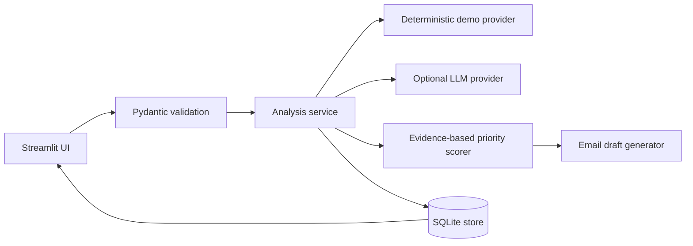

# Technical Approach

## Architecture

`app.py` owns presentation and user interactions. `schemas.py` defines input/output contracts. `lead_analyzer.py` chooses the configured provider and falls back transparently. `demo_provider.py` is deterministic. `llm_provider.py` is an optional OpenAI-compatible adapter. `prioritization.py` is separate from model prose. `csv_processor.py` validates rows and reports duplicates/errors. `data_store.py` uses parameterized SQLite statements.

## Data flow and contracts

Text/form or CSV → `LeadInput` → provider analysis → `LeadAnalysis` validation → deterministic priority recomputation → score/status persistence → dashboard/export. Unknown budget and timeline remain `Unknown`. Analysis includes summary, business problem, service, requirements, budget, timeline, priority, rationale, confidence, missing information, next action, score, status, and draft. The intake screen keeps the draft across reruns and offers a reviewed-text download; sending is intentionally absent.

## Model and prompt choices

The provider is optional so the assessment remains runnable without paid credentials. The configured adapter defaults to `gpt-4o-mini` via `OPENAI_MODEL`, low temperature, JSON response mode, a 20-second timeout, and Pydantic validation. The system prompt treats enquiry text as untrusted data, forbids invented facts, and requires unknown values where evidence is absent. After a successful LLM call, the application recomputes priority, score, and rationale using the deterministic scorer; it does not trust model-generated triage values. Unsupported budget/timeline claims are reset to `Unknown` unless the enquiry contains an explicit signal. The current implementation does not claim model accuracy or production readiness.

## Prioritization methodology

The score is 0–100: explicit urgency 30, provided timeline 15, concrete project action 25, mapping to published service areas 15, and sufficiently detailed enquiry 15. High is ≥70, Medium ≥40, otherwise Low. Rationale records the matching evidence. This is a transparent triage aid, not a prediction of revenue, budget, or purchase intent.

## Security, privacy, and operations

Keys are read from environment variables and never stored in the database. Enquiries are sent to an LLM only when the user opts in and a server-side key exists; a production version should add redaction, retention controls, access control, encryption, and consent review. Failures fall back to demo mode in the current UI; production should distinguish provider outages from intentional demo operation in telemetry. SQLite is appropriate for the local PoC, not a multi-user production deployment.

## Testing and deployment

Pytest covers validation, scoring, demo output, CSV errors/duplicates, and SQLite round trips without API calls. Streamlit Community Cloud should be configured to Python 3.12 in the deployment dialog's Advanced settings; the repository does not use `runtime.txt` because current Community Cloud controls Python version in the app settings. The pinned requirements were verified in a clean Python 3.12 environment with binary wheels. Configure secrets in the platform rather than committing `.env`. The app remains usable with no secret through demo mode.

## Known limitations

There is no CRM integration, authentication, redaction service, production monitoring, formal fairness evaluation, or labelled accuracy benchmark. LLM output handling should add retry/backoff, provider-specific structured-output support, and an evaluation harness before production.
